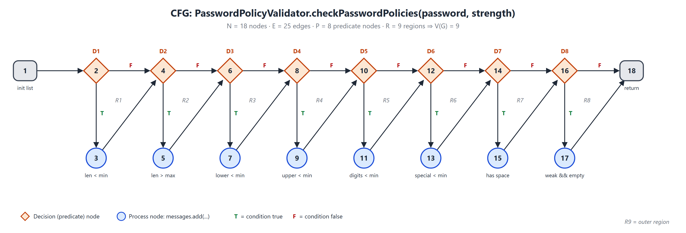

# Automated Web Testing Pipeline: Selenium, JUnit 5 & Formal QA Design

End-to-end test automation of **OrangeHRM OS 5.9**, an open-source HR management web app, built with **Selenium WebDriver 4 + JUnit 5** using the **Page Object Model**. Every test case comes from a formal technique:

| Technique | Where it is designed | Where it is automated |
|---|---|---|
| Equivalence Class Partitioning (ECP) | `docs/Test-Design-ECP-BVA.docx` §2 | `LoginEcpTest`, `AddEmployeeBvaTest`, `AddUserValidationTest` |
| Boundary Value Analysis (7-point BVA) | §3 | `AddEmployeeBvaTest`, `AddUserValidationTest` |
| White-box: CFG, Cyclomatic Complexity, Basis Paths | §4 | `PasswordPolicyWhiteBoxTest` |

* **Course:** Software Testing & Quality Assurance ([Course Code])
* **Team:** [Student A Name] ([USN-A]) is the Automation Architect & Framework Engineer. [Student B Name] ([USN-B]) is the Test Designer & White-Box Specialist. Section [Section].
* **Application under test:** https://opensource-demo.orangehrmlive.com/web/index.php/auth/login (public demo, credentials `Admin` / `admin123` are shown on its login page)

---

## 1. Tech stack

| Purpose | Library | Version |
|---|---|---|
| Language | Java | 17+ (tested on JDK 23) |
| Build | Apache Maven (via the included Maven Wrapper) | 3.9.9 |
| Browser automation | Selenium WebDriver | 4.27.0 |
| Driver management | WebDriverManager | 5.9.2 |
| Test framework | JUnit 5 (Jupiter + Params) | 5.11.4 |
| Assertions | AssertJ | 3.26.3 |
| Browser | Google Chrome | latest stable |

## 2. Project structure

```
SQATpractical/
├── pom.xml                         Maven build: dependencies + Surefire
├── mvnw, mvnw.cmd, .mvn/           Maven Wrapper (no Maven install needed)
├── docs/
│   ├── Test-Design-ECP-BVA.docx    Formal ECP / BVA / CFG / basis-path design (+ PDF)
│   ├── Presentation.pptx           11-slide project presentation
│   ├── images/cfg.png|svg          Control Flow Graph
│   └── evidence/                   Put your screenshots, report and demo GIF here
└── src/
    ├── main/java/com/sqat/orangehrm/
    │   ├── base/BasePage.java              Shared waits + reusable actions (no assertions)
    │   ├── config/ConfigReader.java        config.properties + -D overrides
    │   ├── constants/Messages.java         Exact OrangeHRM UI messages
    │   ├── driver/DriverFactory.java       Chrome setup via WebDriverManager
    │   ├── pages/                          Page Objects
    │   │   ├── LoginPage, DashboardPage, AddEmployeePage,
    │   │   ├── PersonalDetailsPage, AddUserPage, AuthenticatedPage
    │   │   └── components/SideMenu, TopBar
    │   └── validation/                     White-box subject
    │       ├── PasswordPolicy.java
    │       └── PasswordPolicyValidator.java  (port of OrangeHRM checkPasswordPolicies)
    ├── main/resources/config.properties
    └── test/
        ├── java/com/sqat/orangehrm/
        │   ├── base/BaseTest.java              WebDriver lifecycle (@BeforeEach / @AfterEach)
        │   ├── extensions/ScreenshotOnFailureExtension.java
        │   ├── data/                           BoundaryValues, StringGenerator, TestDataProvider
        │   └── tests/                          LoginEcpTest, AddEmployeeBvaTest,
        │                                       AddUserValidationTest, NavigationSmokeTest,
        │                                       PasswordPolicyWhiteBoxTest
        └── resources/
            ├── testdata/employee_id_ecp.csv    @CsvFileSource data
            └── junit-platform.properties
```

## 3. Setup, step by step

### 3.1 Prerequisites
1. **JDK 17 or newer.** Check with `java -version`. Download from https://adoptium.net if needed.
2. **Google Chrome.** WebDriverManager downloads the matching chromedriver automatically.
3. **Git.** Optional, used to clone the repository.
4. **Eclipse IDE for Java Developers.** Optional; IntelliJ IDEA also works.

You do **not** need to install Maven: the project ships with the Maven Wrapper (`mvnw` / `mvnw.cmd`).

### 3.2 Get the code
```bash
git clone https://github.com/amandaabreo2006/SQATpractical.git
cd SQATpractical
```

### 3.3 Run from the command line
Windows (PowerShell or cmd):
```bash
.\mvnw.cmd clean test
```
macOS / Linux:
```bash
./mvnw clean test
```

Useful variations:

| Goal | Command |
|---|---|
| Only the white-box unit tests (no browser, < 1 s) | `mvnw test -Dgroups=whitebox` |
| Only the Selenium UI tests | `mvnw test -Dgroups=ui` |
| One class | `mvnw test -Dtest=LoginEcpTest` |
| Headless Chrome (no window) | `mvnw test -Dheadless=true` |
| Slower network: longer waits | `mvnw test -Dexplicit.wait.seconds=30` |
| HTML test report | `mvnw surefire-report:report` then open `target/reports/surefire.html` |

Results are written to `target/surefire-reports/`. Screenshots of failed UI tests go to `target/screenshots/`.

### 3.4 Run in Eclipse
1. Go to **File → Import → Maven → Existing Maven Projects**, choose the `SQATpractical` folder, and click **Finish**.
2. Wait for Eclipse to download the dependencies (progress is shown at the bottom right).
3. Right-click `src/test/java`, then **Run As → JUnit Test**.
4. The **JUnit** view shows every test, including each parameterized row. Take the screenshot for Slide 10 here, with the green bar and counts visible.

> If Eclipse reports a JRE mismatch, open **Project → Properties → Java Build Path** and choose JDK 17 or newer.

## 4. Framework design

* **Page Object Model.** Locators and page actions live in `src/main/.../pages`. Test classes only call page methods and assert. No page class contains an assertion.
* **Locator strategies.** The framework uses `@FindBy(name=…)` and `@FindBy(css=…)` through PageFactory, plus `By.cssSelector` and `By.xpath`. The label-based helper `fieldByLabel("Username")` finds a field's container from its visible label, so tests don't depend on generated CSS.
* **Waits.** All waits are explicit (`WebDriverWait`, `ExpectedConditions`, `FluentWait`). The implicit wait is 0 and there is no `Thread.sleep`. `BasePage.waitForText` polls for the expected message but never throws, so a failing assertion shows the *actual* message.
* **Driver lifecycle.** Each test gets a fresh Chrome in `@BeforeEach`, and it is always quit in `@AfterEach`. Tests are independent and can run in any order.
* **Safe on a shared demo.** Validation tests always leave one mandatory field empty, so the form can't be saved. The single end-to-end test creates an employee with a unique name and deletes it afterwards through OrangeHRM's REST API.

## 5. Test inventory

| Class | Technique | JUnit 5 feature | Cases |
|---|---|---|---|
| LoginEcpTest | ECP + logout | `@ParameterizedTest @CsvSource`, `@Test` | 10 |
| AddEmployeeBvaTest | BVA ×2, ECP, E2E | `@MethodSource`, `@CsvFileSource`, `@Test` | 19 |
| AddUserValidationTest | BVA ×2, ECP ×2 | `@MethodSource`, `@CsvSource` | 19 |
| NavigationSmokeTest | Smoke | `@CsvSource`, `@ValueSource` | 15 |
| PasswordPolicyWhiteBoxTest | Basis paths + condition coverage | `@MethodSource`, `@Test` | 11 |
| **Total** | | | **74** |

## 6. White-box summary

`PasswordPolicyValidator.checkPasswordPolicies()` is a port of OrangeHRM's server-side `PasswordStrengthService::checkPasswordPolicies()`. Its Control Flow Graph has **N = 18** nodes, **E = 25** edges and **P = 8** predicate nodes:

* V(G) = E − N + 2 = 25 − 18 + 2 = **9**
* V(G) = P + 1 = 8 + 1 = **9**
* V(G) = regions = 8 inner + 1 outer = **9**

There is one test per independent basis path (BP1–BP9). One extra test covers the compound condition in D8, and another checks a password with several violations at once.



## 7. Troubleshooting

| Symptom | Fix |
|---|---|
| `SessionNotCreatedException`: Chrome version mismatch | Update Chrome, or delete `~/.cache/selenium`, then rerun |
| Timeouts on a slow connection | `-Dexplicit.wait.seconds=30` |
| Password BVA min-length cases fail | The demo's password policy was changed. Set `password.min.length` in `config.properties` to match |
| Login fails for every test | The public demo is down or resetting. Wait a few minutes |

## 8. Evidence

Add these files to `docs/evidence/`:
* `eclipse-junit-green.png`: the Eclipse JUnit view with all tests passing
* `surefire-report.png`: the HTML report summary
* `demo.gif` or `demo.mp4`: a recording of a test run. Run with `-Dheadless=false` and record with ScreenToGif or OBS.
